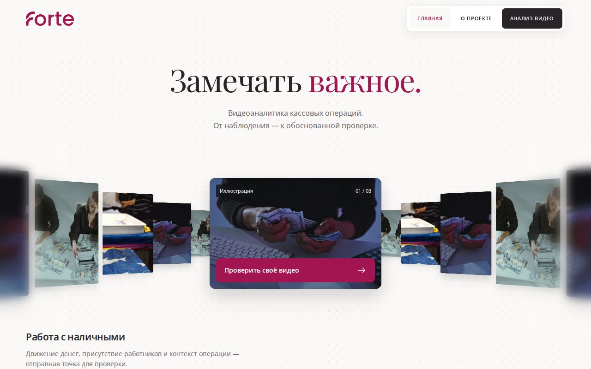
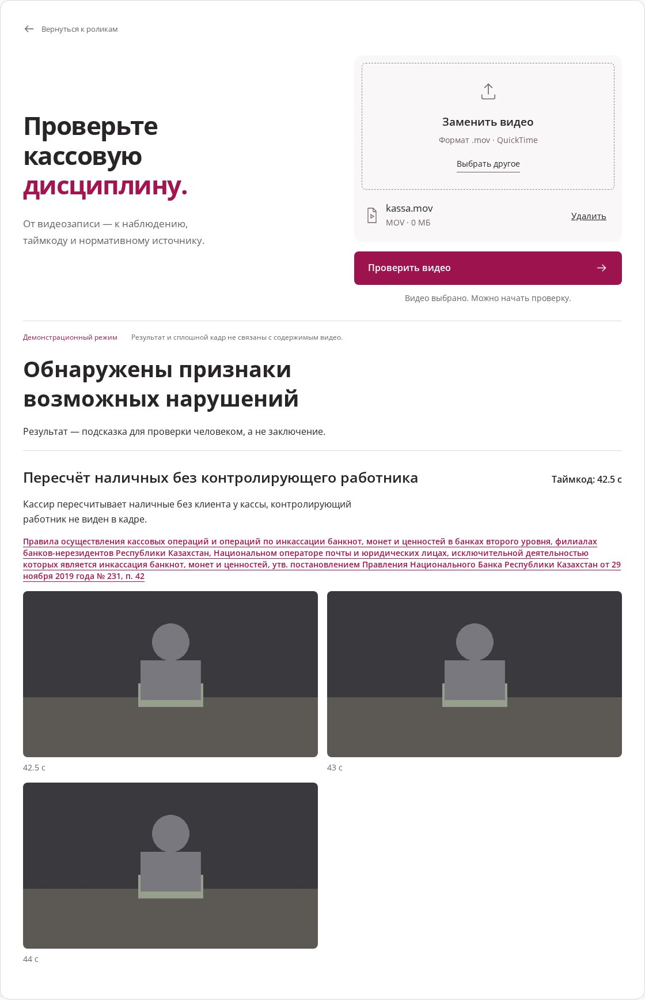
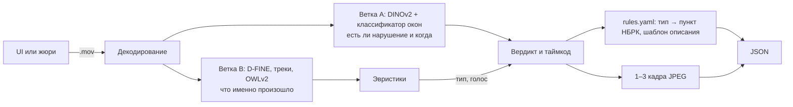

# Forte Datathon '26: кассовая дисциплина по видео

Загружаете видео кассы (.mov), получаете ответ: есть ли признаки нарушения, на какой секунде смотреть, кадры-доказательства и пункт норматива НБРК. Решение остаётся за проверяющим, сервис только подсказывает, куда смотреть.

Всё работает локально на нашей машине: облачные AI-сервисы не используются ни для видео, ни для описаний (TZ-7.3). Загруженное видео удаляется после проверки и в обучение не идёт.



## Запуск

Нужны [uv](https://docs.astral.sh/uv/), Node.js 20+ и make. Как поставить их на Ubuntu, Mac и Windows, описано в [`docs/SETUP.md`](docs/SETUP.md).

```bash
git clone https://github.com/M1kado0/forte-datathon.git && cd forte-datathon
cp .env.example .env              # впишите длинный случайный API_KEY
make setup                        # Python-зависимости и web/
make test
make app FORTE_ANALYZER=stub      # UI и API на http://localhost:8000, без моделей
```

В режиме `stub` сервис отвечает по контракту, но вместо анализа отдаёт заглушку. Для настоящего анализа нужны веса и обученная модель окон:

```bash
make weights    # один раз скачивает модели в models/weights, дальше сеть не нужна
make all        # нужен датасет: data/raw/open_labels.xlsx и data/raw/videos/*.mov
make app
```

`make all` обучает модель окон (`models/window_clf.pkl`) и пересобирает метрики, справочник типов и графики. Датасет в git не лежит.

Другие команды: `make dev` (перезагрузка, UI на :5173), `make tunnel` (публичный адрес через ngrok), `make jury-sim PUBLIC_URL=...` (прогон как у жюри). Постоянный адрес для жюри поднят через Tailscale Funnel, подробности в [`docs/SERVING.md`](docs/SERVING.md).

<details>
<summary>Без make (Windows без WSL)</summary>

```powershell
Copy-Item .env.example .env
uv sync
npm ci --prefix web
uv run pytest
npm run build --prefix web
$env:FORTE_ANALYZER = "stub"
uv run uvicorn api.main:app --host 0.0.0.0 --port 8000
```

Веса: `uv run python -m scripts.weights`. Обучение модели окон и метрики: `uv run python -m src.rules.types_doc`, затем `uv run python -m src.pipeline`.
</details>

## Как пользоваться

**В браузере.** Откройте http://localhost:8000, нажмите «Проверить своё видео», выберите .mov. Для каждого найденного нарушения сервис покажет тип, таймкод, описание, ссылку на норматив и до трёх кадров.



*Снимок интерфейса в демонстрационном режиме: результат и кадры синтетические.*

**Через API.** Каждый запрос к `/api/v1/*` должен нести заголовок `X-API-Key`, иначе сервис ответит 401.

```bash
curl -X POST localhost:8000/api/v1/analyze -H "X-API-Key: $API_KEY" -F "file=@X-1.mov"
# {"job_id":"3f2a..."}

curl localhost:8000/api/v1/jobs/3f2a... -H "X-API-Key: $API_KEY"
```

```json
{
  "job_id": "3f2a...",
  "status": "done",
  "verdict": "violation",
  "violations": [{
    "type": "Иное подозрительное действие",
    "timecode_sec": 41.5,
    "description": "…",
    "evidence_frames": [{"timestamp_sec": 41.5, "image_base64": "…"}]
  }]
}
```

Поля задаёт раздел 10 брифа. `status` может быть `processing`, `done` или `failed`. `verdict` равен `violation` тогда и только тогда, когда список `violations` не пуст. Принимаются только .mov. Очередь хранится в памяти, поэтому uvicorn запускается одним процессом, а после перезапуска старые `job_id` пропадают. Без ключа отвечает `GET /api/health`. Схемы описаны в [`contracts/schemas.py`](contracts/schemas.py).

## Как это устроено



**Ветка A** ([`src/models/`](src/models/)) режет видео на короткие окна внахлёст, считает эмбеддинги DINOv2 и прогоняет их через логистическую регрессию. Порог подобран так, чтобы не пропустить ни одного нарушения, а уже потом снижать ложные срабатывания ([ADR 0002](docs/adr/0002-threshold-recall-first.md)).

**Ветка B** ([`src/features/`](src/features/), [`src/heuristics/`](src/heuristics/)) находит людей, предметы и деньги, а эвристики проверяют наблюдаемые факты: кто у кассы, где лежат деньги, есть ли клиент. По этим фактам выбирается тип нарушения. Отдельный классификатор типов не обучаем, потому что на каждый тип приходится всего несколько примеров. Позу людей не используем: готовые веса обучены на некоммерческих данных.

**Описания** не генерируются. Каждому типу соответствует шаблон в [`src/rules/rules.yaml`](src/rules/rules.yaml) с пунктом норматива и цитатой с adilet. Источники и логика сопоставления описаны в [`docs/RULES.md`](docs/RULES.md), список типов в [`docs/TYPES.md`](docs/TYPES.md).

### Что подключено сейчас

- Ветка A работает в сервисе ([#29](https://github.com/M1kado0/forte-datathon/issues/29)). Если веса и модель на месте, `/api/health` отдаёт `model_loaded: true`.
- Детекции и эвристики готовы ([#32](https://github.com/M1kado0/forte-datathon/issues/32), [#33](https://github.com/M1kado0/forte-datathon/issues/33)), но к `analyze(path)` ещё не подключены ([#34](https://github.com/M1kado0/forte-datathon/issues/34)). Пока каждое нарушение получает тип «Иное подозрительное действие» без точного пункта ([ADR 0005](docs/adr/0005-scenario-taxonomy.md)).

## Модели

| Модель | Зачем | Лицензия |
|---|---|---|
| DINOv2-small | эмбеддинги кадров, ветка A | Apache-2.0 |
| D-FINE-S | люди и предметы, ветка B | Apache-2.0 |
| OWLv2 | поиск денег по тексту, ветка B | Apache-2.0 |
| SigLIP-base | запасные эмбеддинги, в сервисе не используется | Apache-2.0 |

Берём только модели под Apache-2.0, MIT или BSD, поэтому Ultralytics YOLO (AGPL) не используем. Полный список библиотек и исключений лежит в [`docs/MODELS.md`](docs/MODELS.md).

## Числа

Чисел, набранных руками, в README нет: все результаты считает `make all`. Последние метрики модели (recall по видео, доля ложных срабатываний, ошибка таймкода, порог) лежат в [`reports/metrics.json`](reports/metrics.json). История запусков записана в [`experiments.csv`](experiments.csv), проверенные гипотезы в [`docs/INSIGHTS.md`](docs/INSIGHTS.md), описание данных в [`docs/DATA_CARD.md`](docs/DATA_CARD.md).

## Ограничения

- **Ложные срабатывания.** Мы их допускаем сознательно: порог выбран так, чтобы не пропустить ни одного нарушения, поэтому часть чистых видео тоже помечается. Их долю показывает поле `fp_rate` в `reports/metrics.json`.
- **Оценка порога, скорее всего, завышена.** Порог подбирали по схеме «одно видео за раз» (leave-one-video-out). Но многие ролики сняты в одной и той же обстановке, и модель видит почти тот же кадр в обучении. Честная проверка на невиданной расстановке и ракурсе ведётся в [#38](https://github.com/M1kado0/forte-datathon/issues/38).
- **Тип нарушения пока не определяется:** до [#34](https://github.com/M1kado0/forte-datathon/issues/34) все находки приходят как «Иное подозрительное действие».
- **Сервис не утверждает нарушения, которые нельзя увидеть на видео** (проводки, сверки), и не распознаёт лица.
