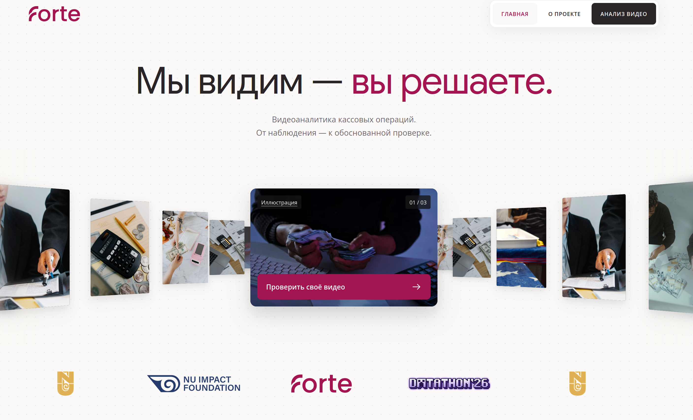
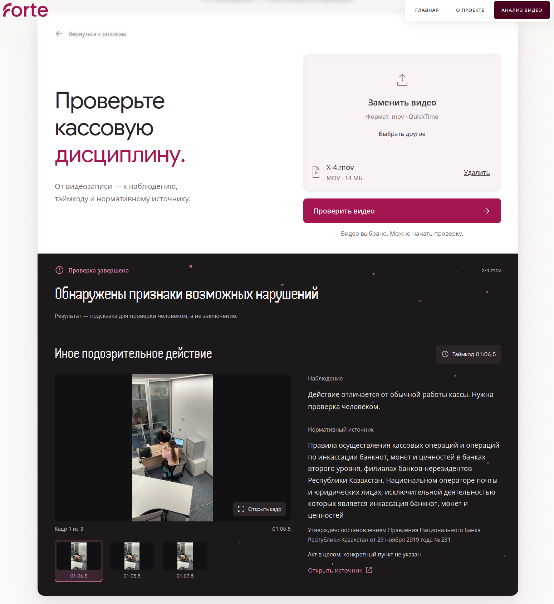
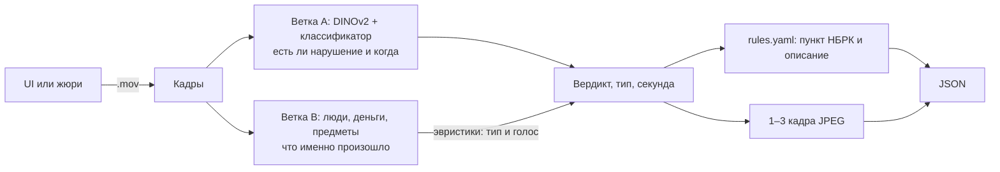

# Forte Datathon '26: кассовая дисциплина по видео

Загружаете видео кассы (.mov), сервис отвечает, есть ли нарушение. Если есть, показывает секунду, кадры и пункт норматива НБРК. Окончательное решение за проверяющим.

Всё работает на нашей машине, без облачных AI-сервисов. Видео удаляется после проверки и в обучение не попадает. Лица сервис не распознаёт.



## Запуск

Понадобятся [uv](https://docs.astral.sh/uv/), Node.js 20+ и make. Как их поставить: [`docs/SETUP.md`](docs/SETUP.md).

**Попробовать без моделей** (ответы-заглушки, но интерфейс и API настоящие):

```bash
git clone https://github.com/M1kado0/forte-datathon.git && cd forte-datathon
cp .env.example .env              # впишите в API_KEY любую длинную строку
make setup
make app FORTE_ANALYZER=stub      # откройте http://localhost:8000
```

**С настоящим анализом:**

```bash
make weights    # скачивает модели один раз, дальше интернет не нужен
make all        # обучает модель и считает метрики; нужны видео в data/raw/videos/
make app
```

Видео датасета в git нет, разметка есть (`data/labels.csv`). Без весов и обученной модели `make app` не запустится.

Ещё пригодится: `make test` (тесты), `make dev` (UI на :5173 с перезагрузкой), `make tunnel` (публичный адрес), `make jury-sim PUBLIC_URL=...` (проверка так, как будет проверять жюри). Постоянный адрес для жюри описан в [`docs/SERVING.md`](docs/SERVING.md).

<details>
<summary>Windows без make</summary>

```powershell
Copy-Item .env.example .env
uv sync
npm ci --prefix web
npm run build --prefix web
$env:FORTE_ANALYZER = "stub"
uv run uvicorn api.main:app --host 0.0.0.0 --port 8000
```

Вместо `make weights`: `uv run python -m scripts.weights`. Вместо `make all` три команды по очереди: `uv run python -m src.rules.types_doc`, `uv run python -m src.pipeline`, `uv run python -m src.data.insights`.
</details>

## Как пользоваться

### В браузере

Откройте http://localhost:8000, нажмите «Проверить своё видео» и выберите .mov. Для каждого нарушения увидите тип, секунду, описание, норматив и до трёх кадров.



*Снимок в режиме заглушки: результат и кадры не настоящие.*

### Через API

Отправьте видео, получите `job_id`, потом спрашивайте результат по нему. Каждый запрос к `/api/v1/*` нужен с заголовком `X-API-Key`, иначе ответ 401.

```bash
curl -X POST localhost:8000/api/v1/analyze -H "X-API-Key: $API_KEY" -F "file=@X-1.mov"
# {"job_id":"3f2a..."}

curl localhost:8000/api/v1/jobs/3f2a... -H "X-API-Key: $API_KEY"
```

```json
{
  "job_id": "3f2a...",
  "status": "done",
  "verdict": "violation",
  "violations": [{
    "type": "Наличные оставлены на столе вместо сейфа",
    "timecode_sec": 41.5,
    "description": "…",
    "evidence_frames": [{"timestamp_sec": 41.5, "image_base64": "…"}]
  }]
}
```

Что важно знать:

- `status`: `processing`, `done` или `failed`. Пока `processing`, повторите запрос позже.
- `verdict` равен `violation`, только если список `violations` не пуст.
- Принимается только .mov, остальное получает 422.
- Очередь живёт в памяти: запускайте один процесс uvicorn. После перезапуска старые `job_id` пропадают.
- `GET /api/health` работает без ключа.

Поля заданы разделом 10 брифа, схемы лежат в [`contracts/schemas.py`](contracts/schemas.py).

## Как это устроено



**Ветка A** ([`src/models/`](src/models/)) нарезает видео на короткие окна, считает для них эмбеддинги DINOv2 и оценивает каждое логистической регрессией. Порог подобран так, чтобы не пропустить ни одного нарушения, и только потом снижать ложные срабатывания ([ADR 0002](docs/adr/0002-threshold-recall-first.md)). Сказать «нарушения нет» ветка A сейчас не может: при проверке, где откладывается вся сцена, её оценки не лучше случайных, поэтому она только помогает выбрать секунду ([ADR 0006](docs/adr/0006-fail-safe-verdict-scene-cv.md)).

**Ветка B** ([`src/features/`](src/features/), [`src/heuristics/`](src/heuristics/)) находит на кадрах людей, деньги и предметы и следит за ними во времени. Эвристики проверяют простые факты: кто у кассы, где лежат деньги, есть ли клиент. По ним выбирается тип нарушения. Если эвристика уверена, она может сама поднять нарушение.

**Решение** ([`src/models/violations.py`](src/models/violations.py)): сейчас признаки нарушения ставятся каждому видео ([ADR 0006](docs/adr/0006-fail-safe-verdict-scene-cv.md)), потому что пропуск недопустим, а отличать чистое видео модель пока не умеет. Тип берётся из эвристики, затем по похожим примерам из датасета. Если ничего не подошло, ставится «Иное подозрительное действие».

**Описания** не генерируются. У каждого типа есть шаблон в [`src/rules/rules.yaml`](src/rules/rules.yaml) с пунктом норматива и цитатой с adilet. Подробнее: [`docs/RULES.md`](docs/RULES.md), список типов: [`docs/TYPES.md`](docs/TYPES.md).

## Модели

| Модель | Зачем | Лицензия |
|---|---|---|
| DINOv2-small | эмбеддинги кадров, ветка A | Apache-2.0 |
| D-FINE-S | люди и предметы, ветка B | Apache-2.0 |
| OWLv2 | деньги и документы по тексту, ветка B | Apache-2.0 |
| SigLIP-base | запасные эмбеддинги, в сервисе не используется | Apache-2.0 |

Берём только Apache-2.0, MIT или BSD, поэтому без Ultralytics YOLO (AGPL). Позу людей не определяем: готовые веса обучены на некоммерческих данных. Полный список: [`docs/MODELS.md`](docs/MODELS.md).

## Числа

Все числа считает `make all`, поэтому в README их нет. Метрики: [`reports/metrics.json`](reports/metrics.json). История запусков: [`experiments.csv`](experiments.csv). Гипотезы: [`docs/INSIGHTS.md`](docs/INSIGHTS.md). Данные: [`docs/DATA_CARD.md`](docs/DATA_CARD.md).

## Ограничения

- **Каждое видео помечается как нарушение.** Когда откладывается вся сцена, модель отличает нарушение от чистого видео не лучше случайного, а на другом ракурсе её оценки падают почти до нуля. Поэтому её «нарушения нет» отключено ([ADR 0006](docs/adr/0006-fail-safe-verdict-scene-cv.md)): пропусков нет, но чистое видео тоже помечено, чаще всего как «Иное подозрительное действие». Числа: [`reports/scene_cv.json`](reports/scene_cv.json).
- **Проверка с откладыванием одного видео ничего не говорит о новых видео.** У каждого нарушения в датасете есть чистый дубль той же сцены, и при такой проверке он остаётся в обучении. Честная проверка откладывает всю сцену ([`data/scenes.csv`](data/scenes.csv)). Разбор в [#38](https://github.com/M1kado0/forte-datathon/issues/38).
- **Другой ракурс проверен только виртуальной камерой** на нескольких видео: зеркало, поворот, наклон и зум. Своих съёмок нет, все видео постановочные: одна касса, одна камера сверху ([#43](https://github.com/M1kado0/forte-datathon/issues/43)).
- **Тип определяется не всегда.** Часть находок приходит как «Иное подозрительное действие».
- **Сервис говорит только о том, что видно.** Проводки, сверки и прочее, чего нет на видео, он не оценивает.
