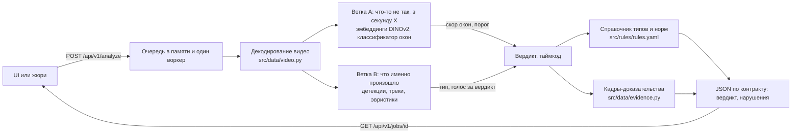

# Forte Datathon '26: проверка кассовой дисциплины по видео

Локальный сервис ForteBank-кейса. Вы загружаете видео кассы (.mov), сервис отвечает: есть ли признаки возможных нарушений, в какую секунду смотреть, какой кадр это показывает и какой пункт норматива НБРК подходит.
Это подсказка проверяющему, а не юридический вывод. Решение принимает человек.

Все модели работают на нашей машине. Облачные AI-сервисы не используются ни для видео, ни для кадров, ни для описаний (TZ-7.3).
Загруженное видео удаляется после задачи и не идёт в обучение.

- Требования брифа и где их смотреть: [`docs/acceptance.md`](docs/acceptance.md)
- Термины (вердикт, нарушение, окно, расстановка, эвристика): [`GLOSSARY.md`](GLOSSARY.md)
- Публичный адрес UI и API и API-ключ жюри получает в форме подачи (TZ-8.1). Ключ в репозиторий не кладём.

## Запуск

Нужны Python 3.11+ (его скачает сам [uv](https://docs.astral.sh/uv/)), uv, Node.js 20+ и npm. `make` нужен только для коротких команд: на Windows без WSL используйте строки `uv run` и `npm` рядом с ними.
Подробнее про установку инструментов по системам: [`docs/SETUP.md`](docs/SETUP.md).

```bash
git clone git@github.com:M1kado0/forte-datathon.git && cd forte-datathon
cp .env.example .env     # затем впишите длинный случайный API_KEY в .env
make setup               # зависимости Python и web/
make test                # быстрые детерминированные тесты
make app                 # собирает web и запускает сервис на http://localhost:8000
```

Без `make` (Windows PowerShell, Git Bash, Mac, Ubuntu одинаково):

```bash
uv sync
cd web && npm ci && cd ..
uv run pytest
cd web && npm run build && cd ..
uv run uvicorn api.main:app --host 0.0.0.0 --port 8000
```

В PowerShell вместо `cp` используйте `Copy-Item .env.example .env`.

`make app` не требует ни данных, ни весов: сервис стартует и отвечает по контракту. Веса и данные нужны для анализа реальных видео и для `make all`.

| Что | `make` | Без `make` |
|---|---|---|
| Зависимости | `make setup` | `uv sync` и `cd web && npm ci` |
| Тесты | `make test` | `uv run pytest` |
| Сервис и UI на одном порту | `make app` | `cd web && npm run build`, затем `uv run uvicorn api.main:app --host 0.0.0.0 --port 8000` |
| Разработка с перезагрузкой | `make dev` | в одном окне `uv run uvicorn api.main:app --reload --port 8000`, в другом `cd web && npm run dev` (UI на :5173, `/api` проксируется на :8000) |
| Веса моделей, один раз | `make weights` | `uv run python -m scripts.weights` |
| Проверка весов без интернета | `make weights-check` | `HF_HUB_OFFLINE=1 uv run python -m scripts.weights --check` (PowerShell: сначала `$env:HF_HUB_OFFLINE=1`) |
| Пересобрать все числа | `make all` | `uv run python -m src.rules.types_doc`, затем `uv run python -m src.pipeline` |
| Публичный адрес через ngrok | `make tunnel` | `ngrok http 8000` |
| Симуляция жюри | `make jury-sim PUBLIC_URL=https://...` | `uv run python -m scripts.jury_sim --url https://...` |

Порт меняется так: `make app PORT=9000` или `--port 9000`.

### Веса и данные

Модели скачиваются один раз (`make weights`) в `models/weights`, после этого сервис работает с `HF_HUB_OFFLINE=1`, без сети.
Датасет организаторов в git не лежит: положите `open_labels.xlsx` в `data/raw/` и клипы `.mov` в `data/raw/videos/`.
`make all` читает их и пересобирает разметку, типы, метрики и модель окон.

### Постоянный адрес для жюри

Машина с Ubuntu и RTX 5080 отдаёт сервис через Tailscale Funnel под systemd: [`docs/SERVING.md`](docs/SERVING.md), решение в [`docs/adr/0001-serving-on-ubuntu-rtx-5080.md`](docs/adr/0001-serving-on-ubuntu-rtx-5080.md).

## Использование

### UI

Откройте `http://localhost:8000`, выберите файл .mov и нажмите «Проверить видео». Страница показывает ход проверки, затем вердикт и список нарушений: тип, таймкод, описание, пункт норматива и кадры-доказательства.
UI ходит в `/api/ui/*`: те же обработчики, что у `/api/v1/*`, но без ключа.

### API

Все ручки `/api/v1/*` требуют заголовок `X-API-Key` со значением `API_KEY` из `.env`. Без ключа и с неверным ключом сервис отвечает 401.

```bash
export API_KEY=...   # значение из .env

# Проверка, что сервис жив (ключ не нужен)
curl localhost:8000/api/health

# Отправить видео: сразу вернётся job_id
curl -X POST localhost:8000/api/v1/analyze \
  -H "X-API-Key: $API_KEY" \
  -F "file=@data/raw/videos/X-14.mov"
# {"job_id":"3f2a..."}

# Спросить результат (повторять, пока status = processing)
curl localhost:8000/api/v1/jobs/3f2a... -H "X-API-Key: $API_KEY"
```

Ответ `jobs/{job_id}` строго по разделу 10 брифа, своих полей нет:

```json
{
  "job_id": "3f2a...",
  "status": "done",
  "verdict": "violation",
  "violations": [
    {
      "type": "Наличные на столе при обслуживании следующего клиента",
      "timecode_sec": 41.5,
      "description": "…",
      "evidence_frames": [{"timestamp_sec": 41.5, "image_base64": "…JPEG в base64…"}]
    }
  ]
}
```

- `status`: `processing`, `done` или `failed`. Пока задача не готова, `verdict` пуст, а `violations` пуст.
- `verdict`: `violation` тогда и только тогда, когда список `violations` не пуст; иначе `no_violation`.
- У каждого нарушения от одного до трёх кадров JPEG; `timecode_sec` совпадает с первым кадром с точностью до секунды.
- Загружать можно только `.mov`, иначе 422.
- Очередь живёт в памяти одного процесса: запускайте один процесс uvicorn, без `--workers`. После перезапуска сервиса `job_id` старых задач недействителен.

Чтобы не печатать кадры в терминал, уберите их через `jq` (его ставят отдельно):

```bash
curl -s localhost:8000/api/v1/jobs/3f2a... -H "X-API-Key: $API_KEY" \
  | jq 'del(.violations[].evidence_frames[].image_base64)'
```

В PowerShell используйте `curl.exe` (а не псевдоним `curl`) и `$env:API_KEY`.

Схемы ответов лежат в [`contracts/schemas.py`](contracts/schemas.py), тест контракта в [`tests/test_api.py`](tests/test_api.py).

## Как это устроено



| Часть | Что делает | Где |
|---|---|---|
| Очередь | Одна очередь в памяти, один фоновый воркер, анализатор подставляется. Исключение даёт `failed`, загруженный файл удаляется при любом исходе | [`api/jobs.py`](api/jobs.py), [`api/main.py`](api/main.py) |
| Ветка A | Эмбеддинги кадров DINOv2 → короткие окна внахлёст → логистическая регрессия. Говорит, что в окне что-то не так, и даёт таймкод. Порог выбран по recall 1.0, потом минимум ложных срабатываний ([ADR 0002](docs/adr/0002-threshold-recall-first.md)) | [`src/features/embeddings.py`](src/features/embeddings.py), [`src/models/windows.py`](src/models/windows.py), [`src/models/train.py`](src/models/train.py), [`src/models/analyze.py`](src/models/analyze.py) |
| Ветка B | Детекции людей и предметов (D-FINE-S), треки, деньги (OWLv2 по тексту) → признаки по зонам. Без позы: готовые веса позы обучены на некоммерческих данных | [`src/features/`](src/features/), [`docs/adr/0003-violation-taxonomy.md`](docs/adr/0003-violation-taxonomy.md) |
| Эвристики | Проверяют наблюдаемые факты (кто у кассы, где деньги, какие предметы, есть ли клиент), выбирают тип нарушения и могут поднять вердикт. Это наши проверки, к нормативу они отношения не имеют | [`src/heuristics/`](src/heuristics/) |
| Справочник | Тип нарушения → документ, пункт, цитата, ссылка на adilet и шаблон описания. Описание собирается из шаблона и наблюдённых фактов, юридические выводы не генерируются | [`src/rules/rules.yaml`](src/rules/rules.yaml), [`docs/RULES.md`](docs/RULES.md), [`docs/TYPES.md`](docs/TYPES.md) |
| Кадры-доказательства | От одного до трёх JPEG вокруг таймкода, в base64 | [`src/data/evidence.py`](src/data/evidence.py) |
| API и UI | FastAPI отдаёт `/api/v1`, `/api/ui` и собранный `web/dist` на одном порту; UI на React, Tailwind и токенах Forte | [`api/`](api/), [`web/`](web/) |

Если ни один тип не подходит, нарушение получает тип «Иное подозрительное действие» без точного пункта ([ADR 0005](docs/adr/0005-scenario-taxonomy.md)).
Классификатор типов не обучаем: на тип приходится слишком мало примеров, поэтому тип выбирают эвристики.

### Что уже подключено к API

Сборка идёт этапами, поэтому статус ниже важнее схемы: он показывает, что ответит сервис прямо сейчас.

| Часть | Статус | Тикет |
|---|---|---|
| Контракт, ключ, очередь, UI | работает; воркер пока вызывает заглушку и отдаёт один запасной тип | [#29](https://github.com/M1kado0/forte-datathon/issues/29) подключает `analyze(path)` к воркеру |
| Ветка A: `analyze(path)` | готова как функция и CLI (`uv run python -m src.models.analyze <видео>`), в воркер ещё не подключена | [#29](https://github.com/M1kado0/forte-datathon/issues/29) |
| Ветка B: детекции и треки | в работе | [#32](https://github.com/M1kado0/forte-datathon/issues/32) |
| Эвристики и их голос за вердикт | первые эвристики готовы ([#24](https://github.com/M1kado0/forte-datathon/issues/24)), остальные в работе | [#33](https://github.com/M1kado0/forte-datathon/issues/33), [#34](https://github.com/M1kado0/forte-datathon/issues/34) |

После слияния этих тикетов `/api/health` отдаёт `model_loaded: true`, а типы нарушений приходят от эвристик. Сейчас `model_loaded` равен `false`.

## Числа

В README нет чисел, набранных руками. Все результаты (recall по видео, доля ложных срабатываний, медианная ошибка таймкода, порог, число размеченных видео) считает `make all`:

- [`reports/metrics.json`](reports/metrics.json) — последняя метрика модели окон;
- [`experiments.csv`](experiments.csv) — по строке на каждый запуск, только дописывается;
- [`docs/TYPES.md`](docs/TYPES.md) — типы нарушений и число меток, собирается из `data/labels.csv`;
- [`docs/DATA_CARD.md`](docs/DATA_CARD.md) — описание данных и расстановок.

Проверка сейчас идёт по схеме «одно видео за раз» (leave-one-video-out), порог выбирается по ней ([ADR 0002](docs/adr/0002-threshold-recall-first.md)). Соседние клипы набора похожи друг на друга (одна сцена), поэтому такая оценка ненадёжна. Проверка на невиданной расстановке и по группам сцен — [#38](https://github.com/M1kado0/forte-datathon/issues/38), её результаты появятся в `reports/metrics.json`.

## Модели и лицензии

Берём только открытые модели с лицензией Apache-2.0, MIT или BSD. Ultralytics YOLO (AGPL-3.0) не используем. Полная таблица моделей, библиотек и принятых исключений: [`docs/MODELS.md`](docs/MODELS.md).

| Модель | Роль | Лицензия |
|---|---|---|
| DINOv2-small (`facebook/dinov2-small`) | эмбеддинги кадров, ветка A | Apache-2.0 |
| D-FINE-S (`ustc-community/dfine-small-coco`) | детекция людей и предметов, ветка B | Apache-2.0 |
| OWLv2 (`google/owlv2-base-patch16-ensemble`) | поиск денег по тексту, ветка B | Apache-2.0 |
| SigLIP-base (`google/siglip-base-patch16-224`) | запасные эмбеддинги | Apache-2.0 |

Исключения из правила лицензий: CUDA-колёса `nvidia-*` в составе torch, FFmpeg (LGPLv2.1) внутри колёс opencv, pillow (HPND), часть кода torch под BSL-1.0. Причины и условия в `docs/MODELS.md`.

## Ограничения

Полный разбор ошибок с названиями клипов будет в [#38](https://github.com/M1kado0/forte-datathon/issues/38) и [#42](https://github.com/M1kado0/forte-datathon/issues/42). Уже известно:

- Порог выбран по recall 1.0, поэтому ложные срабатывания на видео без нарушений есть: это осознанная цена, потому что пропуск нарушения недопустим для банка ([ADR 0002](docs/adr/0002-threshold-recall-first.md)). Сейчас модель окон отличает видео без нарушений слабо: при таком пороге доля ложных срабатываний высока (`fp_rate` в `reports/metrics.json`). Снижать её должны эвристики и порог после #38.
- Обучающие видео сняты одной камерой в двух расстановках, видео жюри может быть снято иначе. Мы проверяем и расстановку, но порог по ней не выбираем.
- Типы нарушений мы определили сами по разметке организаторов (в ней типов нет), а у части типов один–два примера. Для типа без подходящего пункта ссылка ведёт на акт целиком.
- Сервис видит только то, что видно в кадре: звука нет, лица не распознаются.

## Команда

| Роль | Кто |
|---|---|
| Fullstack: API, очередь, UI | Тамерлан |
| ML и CV: эмбеддинги, детекции, порог, `analyze(path)`, машина сервинга | Алдияр С. |
| Инфраструктура и эвристики: зависимости, веса, декодирование, туннель | Ескендир |
| Данные, нормы, документация: разметка, типы, пункты НБРК, README | Алдияр М. |
